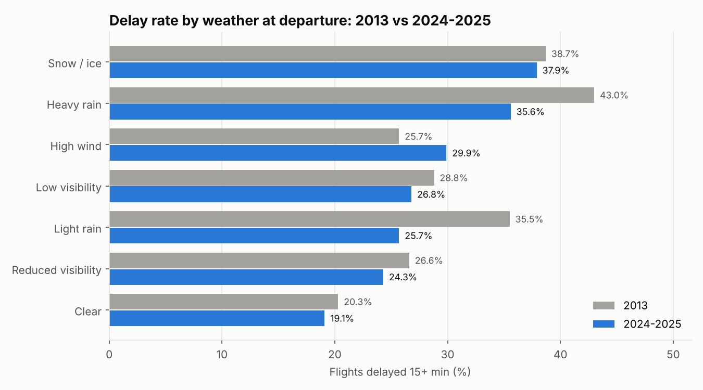
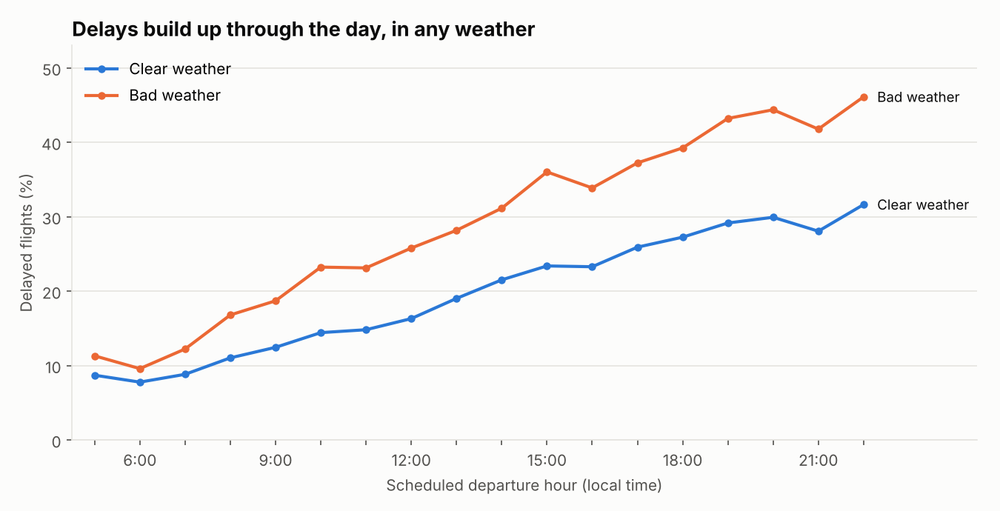
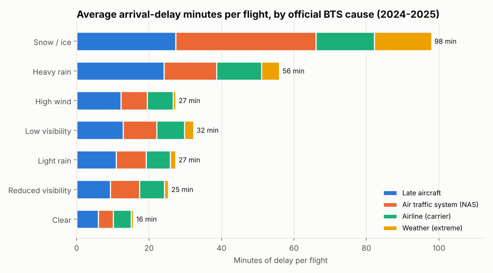
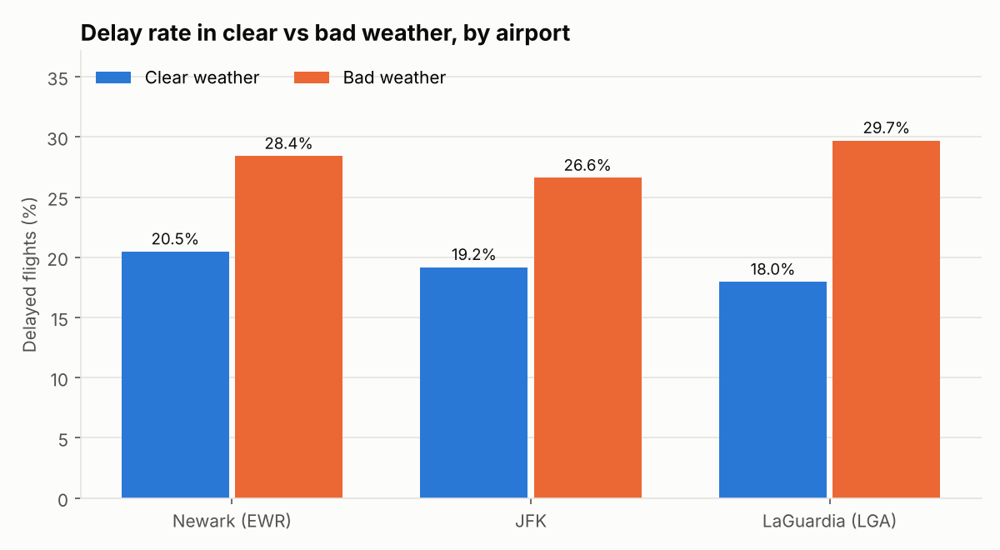
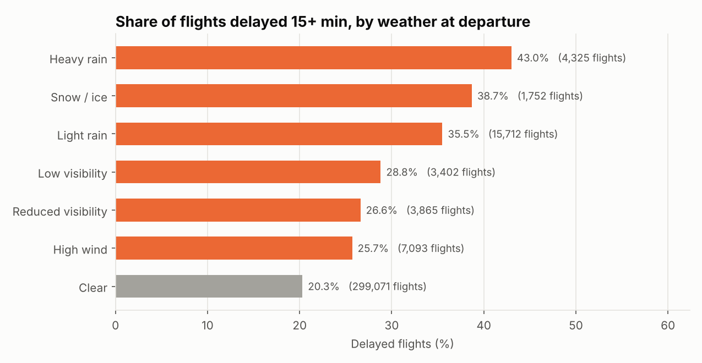
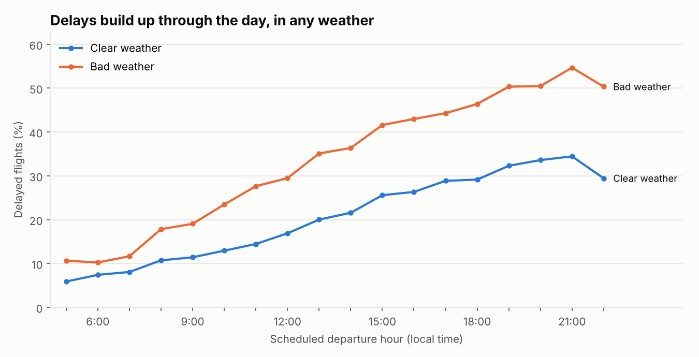
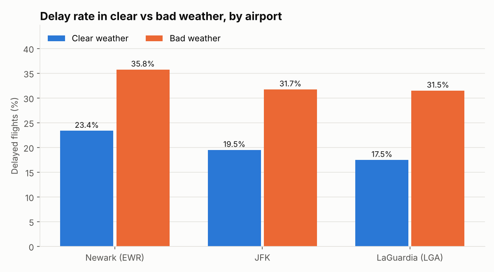
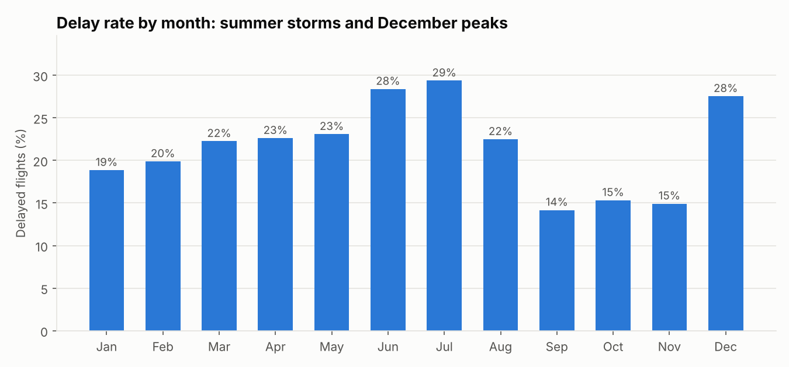
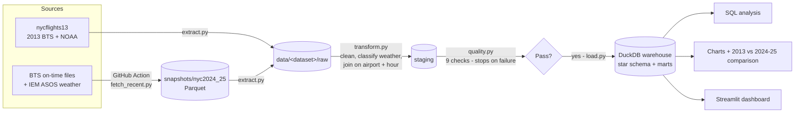

# ✈️ Weather & Flight Delay Pipeline

An end-to-end **data engineering + analytics** project. It takes every flight that left New York City's three airports, **in 2013 and in 2024–2025 (over 1.1 million flights)**, and joins each one to the **weather at its departure airport during its departure hour**. Then it checks data quality, loads a **DuckDB star-schema warehouse**, and answers the question:

> **How much does weather actually delay flights, and what matters more?**

**Stack:** Python · pandas · DuckDB · SQL (star schema, CTEs, aggregations) · pytest · GitHub Actions (CI + scheduled data fetch) · Streamlit · matplotlib

---

## Key findings at a glance

| | 2013 | 2024 | 2025 |
|---|---|---|---|
| Flights analyzed | 336,776 | 414,759 | 360,771 |
| Delayed 15+ min | 21.7% | 19.3% | 21.4% |
| Cancelled | 2.45% | 2.26% | 2.57% |
| Avg departure delay | 12.6 min | 12.3 min | 15.0 min |
| Flights departing in bad weather | 10.7% | 11.4% | 13.5% |

1. **Time of day beats weather, in both periods.** A morning flight in bad weather is less likely to be delayed than an evening flight in clear weather: 17.6% vs 26.6% in 2013, and 16.7% vs 24.6% in 2024–25.
2. **Bad weather raises the delay rate by about half.** In 2024–25, 28.3% of bad-weather flights were delayed, compared with 19.1% in clear weather. In 2013 the gap was wider: 33.0% vs 20.3%.
3. **Weather is mostly a cancellation problem.** In 2024–25, bad-weather flights were 12.4% of all flights but 29.5% of cancellations. Snow and ice cancel about 1 in 4 flights.
4. **Weather hides inside "air traffic system" delays.** The official BTS "weather" cause accounts for only 4.2% of delay minutes. In snow, though, air traffic system delay per flight is 9× its clear-weather level, because weather triggers air traffic control slowdowns.
5. **2025 was worse than 2024**, especially October through December, which coincides with the fall 2025 federal government shutdown.

---

## 2024–2025: what changed?

Data: **775,530 flights** from the BTS on-time database plus **52,578 hours** of weather observations from the airports' own ASOS weather stations. The data is fetched automatically by a GitHub Action (see [Architecture](#architecture)).

**Weather still hurts, but less than in 2013.** Heavy rain delays 35.6% of flights (43.0% in 2013), and light rain 25.7% (35.5% in 2013). Airlines now cancel more readily instead. **14.4% of heavy-rain flights were cancelled, up from 8.4%.** High wind is the exception: it's worse than in 2013 (29.9% vs 25.7%).



**The time-of-day pattern hasn't moved in 11 years.** Delays climb from about 8% for early-morning flights to over 30% by evening, in clear and bad weather alike.



**What actually causes the delays (official BTS causes).** Across 13.3 million minutes of delay in 2024–25:

| Cause | Share of delay minutes |
|---|---|
| Late-arriving aircraft (knock-on delays) | 38.6% |
| Airline (crew, maintenance, cleaning…) | 29.9% |
| Air traffic system (NAS), which includes non-extreme weather | 27.1% |
| Extreme weather | 4.2% |
| Security | 0.1% |

Weather barely shows up under its own name, but splitting the causes by the weather we matched to each flight shows its real footprint. **In snow, flights average 98 delay minutes each, compared with 16 in clear weather.** The biggest piece is air traffic system delay: 39 minutes in snow vs 4 in clear weather. Snow slows the whole network down through air traffic control programs. For cancellations, the official cause codes are 46% weather, 34% air traffic system and 21% airline.



**LaGuardia is still the most weather-sensitive airport.** Its delay rate jumps from 18.0% in clear weather to 29.7% in bad weather (+11.7 points). Newark is the most delay-prone in clear weather (20.5%).



**Worst days, and one that wasn't weather:**

| Date | Delayed | Cancelled | What happened |
|---|---|---|---|
| May 23, 2024 | 59.1% | 96 | Heavy rain: 0.55 in/hr, visibility under 1 mile |
| Dec 14, 2025 | 58.4% | 345 | Snow, visibility down to 0.25 miles |
| **Jul 19, 2024** | **54.5%** | **285** | **Clear weather all day: the CrowdStrike IT outage**, which hit Delta and its regional partner Endeavor hardest |
| Jan 16, 2024 | 50.3% | 285 | Snow |

The CrowdStrike day is a good reminder that the pipeline's weather labels only explain part of the story. The weather-based analysis correctly shows nothing unusual that day, which is exactly why the official cause codes matter.

**2025 vs 2024.** Delays were similar through the summer. Then fall 2025 was much worse: October rose from 12.3% to 20.5% delayed and November from 14.8% to 21.9%. That coincides with the October–November 2025 federal government shutdown, when air traffic controller shortages led the FAA to order flight reductions. Average departure delay in 2025 (15.0 min) was the highest of the three years.

> **Note on flight counts:** 2025 shows about 13% fewer flights than 2024, mostly because Endeavor Air (about 51,000 NYC flights in 2024) doesn't appear in the BTS 2025 data. That's a change in which airlines report to BTS, not a real drop in traffic. So this project compares **rates**, not totals, across years.

---

## 2013 deep dive

**Bad weather doubles the chance of a delay.** In heavy rain, 43.0% of flights left 15+ minutes late, compared with 20.3% in clear weather. Snow and ice pushed cancellations to 23%, 12 times the clear-weather rate.



**Time of day matters even more.** The delay rate climbs from 6% for 5:00 departures to 36% by 21:00, as late aircraft and crews push delays down the line.



**Newark was the most delay-prone; LaGuardia was the most weather-sensitive** (17.5% → 31.5%).



**Summer and December were the worst months.** July had the highest delay rate (29.4%), even though only 5.4% of July departures had bad weather at the NYC airport. Summer thunderstorms elsewhere in the network cause delays the local weather can't explain. The worst day was **March 8, 2013** (a snowstorm): 56.4% delayed, 180 cancelled.



### Recommendations
- **Travelers:** book the first flight of the day. It's a bigger protection against delays than avoiding bad-weather days, and it held true in both 2013 and 2024–25.
- **Airlines and airports:** build schedule buffers into afternoon and evening departures. Treat snow forecasts as cancellation-planning events, and plan for weather showing up as air traffic system delays, not just "weather" delays.
- **Analysts:** add destination and en-route weather. Origin weather alone misses summer thunderstorms and days like Aug 6, 2024 (425 NYC cancellations with fewer than 20% of flights delayed).

---

## Architecture



**Two datasets, one pipeline.** The fetch script converts the 2024–25 sources into the same schema as the 2013 data, so the transform, quality, load and analysis code is shared. Each dataset gets its own warehouse (`data/nyc2013/`, `data/nyc2024_25/`).

**Automated data fetch.** `.github/workflows/fetch-recent.yml` runs `scripts/fetch_recent.py` in GitHub Actions. It downloads 24 monthly BTS files (about 30 MB each), keeps only EWR, JFK and LGA departures, and pulls hourly METAR observations from the Iowa Environmental Mesonet. Then it commits a compact snapshot (about 11 MB of Parquet) back to the repo. The pipeline, tests and dashboard run offline from that snapshot.

### Warehouse model (star schema)

| Table | Grain | Rows (2013 / 2024–25) |
|---|---|---|
| `fact_flights` | one flight | 336,776 / 775,530 |
| `dim_weather_hour` | one airport-hour of weather | 26,115 / 52,578 |
| `dim_airport` | one airport | 1,458 |
| `dim_carrier` | one airline | 16 / 14 |
| `dim_date` | one calendar day | 365 / 731 |
| `mart_delay_by_weather` | one weather condition | 7 |
| `mart_daily_airport` | one airport-day | 1,095 / 2,193 |
| `mart_delay_by_hour` | one departure hour | 19 |

`fact_flights` also carries the official BTS delay-cause minutes (carrier, weather, NAS, security, late aircraft) and cancellation codes. These are filled for 2024–25 and empty for 2013, where the source doesn't include them.

### Weather classification

Every airport-hour gets **one** label, chosen by the highest-impact condition that applies:

| Priority | Condition | Rule |
|---|---|---|
| 1 | Snow / ice | measurable precipitation at or below 32°F |
| 2 | Heavy rain | precipitation of 0.10 in/hr or more |
| 3 | Low visibility | under 1 mile (instrument flight rules) |
| 4 | High wind | sustained 25+ mph or gusts of 35+ mph |
| 5 | Light rain | measurable precipitation (0.01 in or more) |
| 6 | Reduced visibility | 1–3 miles |
| 7 | Clear | none of the above |

### Data quality

The pipeline **stops before loading** if any check fails:

- No flights lost or duplicated in the join
- `flight_id` is unique
- Every origin is EWR, JFK or LGA
- Cancelled flights have no departure delay
- Weather matched for at least 99% of flights (99.5% for 2013, 99.9% for 2024–25)
- Every weather label is valid
- Wind speeds are physically plausible
- Visibility is between 0 and 10 miles
- Scheduled hour is 0–23

Cleaning issues found and fixed along the way:
- A **1,048 mph** wind reading in the 2013 data is nulled.
- **Trace precipitation** is stored as 0.0001 in in the IEM feed but as 0 in the 2013 data. Without a fix, "light rain" would be over-counted 5× in 2024–25, so trace amounts are treated as no measurable precipitation in both.
- **Daylight-saving changeovers**: the repeated 1:00 hour each November can't be matched to a single UTC hour, so those flights get "Unknown" weather instead of a wrong match.
- When several weather reports exist in one hour, the routine hourly report is picked.

The pipeline is **idempotent**: every run rebuilds the warehouse from the raw files.

---

## Project structure

```
weather-flight-delay-pipeline/
├── pipeline/
│   ├── config.py          # datasets, paths, weather thresholds
│   ├── extract.py         # source -> data/<dataset>/raw
│   ├── transform.py       # clean, classify weather, join
│   ├── quality.py         # data quality gate
│   ├── load.py            # build DuckDB warehouse
│   └── run.py             # orchestrator: python -m pipeline.run --dataset ...
├── scripts/fetch_recent.py        # downloads 2024-25 BTS + IEM data (runs in GitHub Actions)
├── snapshots/nyc2024_25/          # committed 2024-25 data snapshot
├── sql/
│   ├── schema.sql                 # star schema
│   ├── marts.sql                  # analysis marts
│   └── analysis_queries.sql       # 10 business questions
├── analysis/
│   ├── make_charts.py             # per-dataset charts
│   └── compare_periods.py         # 2013 vs 2024-25 + BTS delay causes
├── dashboard/app.py               # Streamlit dashboard with dataset + year filters
├── tests/                         # 17 pytest unit tests
├── .github/workflows/
│   ├── pipeline.yml               # CI: tests + both pipelines on every push, weekly
│   └── fetch-recent.yml           # data fetch job
├── Makefile
└── requirements.txt
```

## How to run

```bash
git clone https://github.com/bnabinsu-hash/weather-flight-delay-pipeline.git
cd weather-flight-delay-pipeline
pip install -r requirements.txt

python -m pipeline.run --dataset nyc2013      # build the 2013 warehouse
python -m pipeline.run --dataset nyc2024_25   # build the 2024-25 warehouse
python -m pytest                              # run the tests
python -m analysis.make_charts --dataset nyc2024_25
python -m analysis.compare_periods            # 2013 vs 2024-25 charts
streamlit run dashboard/app.py                # interactive dashboard
```

Or run `make all` to build both datasets, test and chart everything, then `make dashboard`.

To refresh the 2024–25 snapshot, run the **fetch-recent-data** workflow from the repo's **Actions** tab, or run `python scripts/fetch_recent.py` on a machine with internet access.

To query a warehouse yourself, open `data/nyc2024_25/warehouse.duckdb` in the [DuckDB CLI](https://duckdb.org/docs/installation/) or DBeaver and run anything from `sql/analysis_queries.sql`.

### Deploy the dashboard (free)
Go to [share.streamlit.io](https://share.streamlit.io) → **New app** → pick this repo → main file `dashboard/app.py`. Each dataset's warehouse is built on first use.

## Data sources

- **2013:** the [`nycflights13`](https://pypi.org/project/nycflights13/) dataset, with BTS on-time data for all NYC departures plus hourly NOAA weather for EWR, JFK and LGA.
- **2024–2025:** [BTS Reporting Carrier On-Time Performance](https://www.transtats.bts.gov/) monthly files, plus hourly METAR observations from the [Iowa Environmental Mesonet ASOS archive](https://mesonet.agron.iastate.edu/request/download.phtml) for the same three airports.

The two periods use different weather feeds (NOAA via nycflights13 vs IEM METAR). The weather rules are applied identically, but small differences in how each feed records conditions mean cross-period comparisons of *weather frequency* should be read with some care. Comparisons of delay *rates* within each condition are on firmer ground.

## Next steps
- Add destination weather to catch delays caused by storms elsewhere
- Add DFW and other hubs. The fetch script already downloads every US flight; it just needs more airports in its filter.
- Predict delay probability from weather and time of day with a simple model
