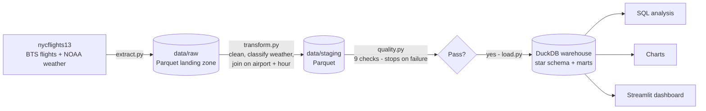

# ✈️ Weather & Flight Delay Pipeline

An end-to-end **data engineering + analytics** project. It extracts every flight that left New York City in 2013 (336,776 flights), joins each one to the **hourly weather at its departure airport**, checks data quality, loads a **DuckDB star-schema warehouse**, and answers the question:

> **How much does weather actually delay flights, and what matters more?**

**Stack:** Python · pandas · DuckDB · SQL (star schema, CTEs, window-style analysis) · pytest · GitHub Actions · Streamlit · matplotlib

---

## Key findings

| | |
|---|---|
| Flights analyzed | **336,776** (EWR, JFK, LGA, all of 2013) |
| Delayed 15+ minutes | **21.7%** |
| Cancelled | **2.45%** |
| Flights matched to weather | **99.5%** |

**1. Bad weather doubles the chance of a delay.** In heavy rain, 43.0% of flights leave 15+ minutes late, compared with 20.3% in clear weather. Snow and ice hit cancellations hardest: 23% of flights are cancelled, 12 times the clear-weather rate.


**2. But time of day matters even more than weather.** The delay rate climbs from 6% for 5:00 departures to 36% by 21:00, as late aircraft and crews push delays down the line. A **morning flight in bad weather (17.6% delayed) is less likely to be late than an evening flight in clear weather (26.6%)**.


**3. Weather causes a third of cancellations but only a sixth of delays.** Just 10.7% of flights departed in bad weather. Those flights account for 16.4% of all delays but 33.1% of all cancellations. Airlines respond to bad weather by cancelling, not just delaying.

**4. Newark is the most delay-prone airport; LaGuardia is the most weather-sensitive.** Newark has the highest delay rate in both clear (23.4%) and bad weather (35.8%). LaGuardia shows the biggest jump when weather turns bad, going from 17.5% to 31.5% (+14.0 points).


**5. Summer and December are the worst months.** July has the highest delay rate (29.4%), even though only 5.4% of July departures had bad weather at the NYC airport itself. Summer thunderstorms elsewhere in the network cause delays that the local weather can't explain. December (27.5%) combines winter storms with holiday traffic.


**6. The worst day of the year was March 8, 2013,** during a snowstorm. 56.4% of flights were delayed and 180 were cancelled.

### Recommendations
- **Travelers:** book the earliest flight of the day. It's a bigger protection against delays than avoiding bad-weather days.
- **Airlines and airports:** build schedule buffers into afternoon and evening banks, especially at Newark. Treat snow forecasts as cancellation planning events rather than delay events.
- **Analysts:** add en-route and destination weather. Origin weather alone misses the summer thunderstorm effect.

---

## Architecture



### Warehouse model (star schema)

| Table | Grain | Rows |
|---|---|---|
| `fact_flights` | one flight | 336,776 |
| `dim_weather_hour` | one airport-hour of weather | 26,115 |
| `dim_airport` | one airport | 1,458 |
| `dim_carrier` | one airline | 16 |
| `dim_date` | one calendar day | 365 |
| `mart_delay_by_weather` | one weather condition | 7 |
| `mart_daily_airport` | one airport-day | 1,095 |
| `mart_delay_by_hour` | one departure hour | 19 |

### Weather classification

Every airport-hour gets **one** label, chosen by the highest-impact condition that applies:

| Priority | Condition | Rule |
|---|---|---|
| 1 | Snow / ice | any precipitation at or below 32°F |
| 2 | Heavy rain | precipitation of 0.10 in/hr or more |
| 3 | Low visibility | under 1 mile (instrument flight rules) |
| 4 | High wind | sustained 25+ mph or gusts of 35+ mph |
| 5 | Light rain | any precipitation |
| 6 | Reduced visibility | 1–3 miles |
| 7 | Clear | none of the above |

### Data quality

The pipeline **stops before loading** if any check fails:

- No flights lost or duplicated in the join
- `flight_id` is unique
- Every origin is EWR, JFK or LGA
- Cancelled flights have no departure delay
- Weather matched for at least 99% of flights
- Every weather label is valid
- Wind speeds are physically plausible. The raw data contains one **1,048 mph** reading, which is nulled during cleaning.
- Visibility is between 0 and 10 miles
- Scheduled hour is 0–23

The pipeline is also **idempotent**: every run rebuilds the warehouse from the raw files, so running it twice gives the same result.

---

## Project structure

```
weather-flight-delay-pipeline/
├── pipeline/
│   ├── config.py          # paths + weather thresholds
│   ├── extract.py         # source -> data/raw (Parquet)
│   ├── transform.py       # clean, classify weather, join
│   ├── quality.py         # data quality gate
│   ├── load.py            # build DuckDB warehouse
│   └── run.py             # orchestrator with logging + timings
├── sql/
│   ├── schema.sql         # star schema
│   ├── marts.sql          # analysis marts
│   └── analysis_queries.sql   # 8 business questions
├── analysis/make_charts.py
├── dashboard/app.py       # Streamlit dashboard
├── tests/                 # 14 pytest unit tests
├── .github/workflows/pipeline.yml   # CI: tests + full run on every push and weekly
├── Makefile
└── requirements.txt
```

## How to run

```bash
git clone https://github.com/bnabinsu-hash/weather-flight-delay-pipeline.git
cd weather-flight-delay-pipeline
pip install -r requirements.txt

python -m pipeline.run          # build the warehouse (about 2 seconds)
python -m pytest                # run the tests
python -m analysis.make_charts  # rebuild the charts
streamlit run dashboard/app.py  # open the interactive dashboard
```

Or use `make all` and `make dashboard`.

To query the warehouse yourself, open `data/warehouse.duckdb` in the [DuckDB CLI](https://duckdb.org/docs/installation/) or DBeaver and run anything from `sql/analysis_queries.sql`.

### Deploy the dashboard (free)
Push to GitHub, then go to [share.streamlit.io](https://share.streamlit.io) → **New app** → pick this repo → main file `dashboard/app.py`. On first load, the app builds the warehouse itself.

## Data source

The [`nycflights13`](https://pypi.org/project/nycflights13/) dataset: on-time data for all flights departing NYC in 2013 from the US Bureau of Transportation Statistics, plus hourly weather from NOAA for EWR, JFK and LGA.

## Next steps
- Swap the extract step for live BTS + Open-Meteo APIs and point it at DFW
- Add destination and en-route weather
- Predict delay probability from weather and time of day with a simple model
